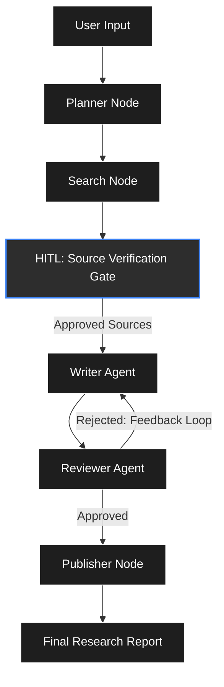

# 🧠 Multi-Agent AI Research System

The Multi-Agent AI Research System is an intelligent orchestration application that combines multiple specialized AI agents to conduct automated web research, synthesize data, and generate factually grounded reports. Built with LangGraph, it features a Human-In-The-Loop (HITL) verification gate and an automated self-correction loop to prevent LLM hallucinations.

### 🌟 Features

*   **Multi-Agent Architecture:** Specialized nodes working in tandem (Planner, Search, Writer, Reviewer, Publisher).
*   **Human-In-The-Loop (HITL) Triage:** A built-in UI checkpoint allowing humans to audit and filter scraped web sources before the AI begins drafting.
*   **Bounded Self-Correction Loop:** An automated "Reviewer" agent grades the drafted report and forces rewrites if facts are missing or citations are hallucinated.
*   **Asynchronous Web Scraping:** Fetches data from multiple web queries simultaneously for high-speed research.
*   **Structured Validation:** Uses Pydantic to force deterministic, strict JSON outputs from the LLM for reliable routing.

### 🛠️ Tech Stack

**Core Components**

| Component | Technology |
| :--- | :--- |
| **Frontend** | Streamlit |
| **LLM Engine** | Google Gemini 2.5 Flash (`langchain-google-genai`) |
| **Orchestration** | LangGraph |
| **Web Search Engine** | Tavily Search API |
| **Data Validation** | Pydantic |

**Supporting Libraries**
*   `asyncio` (for concurrent API calls)
*   `python-dotenv` (for environment variables)


### 🏗️ System Architecture




## 🚀 Getting Started

### Prerequisites

Before running the project, make sure you have:

- Python 3.9+
- Google Gemini API Key
- Tavily Search API Key

### Installation

#### 1. Clone the Repository

```bash
git clone https://github.com/yourusername/multi-agent-research-system.git
cd multi-agent-research-system
```

### 2. Create and activate virtual environment

```bash
python -m venv .venv
.venv\Scripts\activate
```

### 3. Set Up Environment Variables

```bash
GOOGLE_API_KEY="your_gemini_key"
TAVILY_API_KEY="your_tavily_key"
```

### 4. Run

```bash
streamlit run app.py
```
