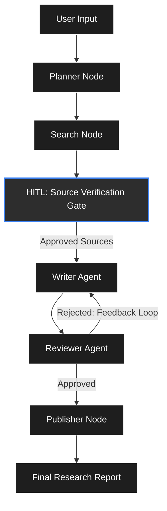

# 🧠 Multi-Agent AI Research Assistant

Demo: https://multi-agent-ai-research-report-generator.streamlit.app

## Demo Video: 
https://github.com/user-attachments/assets/0ec8507e-7475-4f96-8031-803ed63bacbe

The Multi-Agent AI Research System is an intelligent orchestration application that combines multiple specialized AI agents to conduct automated web research, synthesize data, and generate factually grounded reports. Built with LangGraph, it features a Human-In-The-Loop (HITL) verification gate and an automated self-correction loop to prevent LLM hallucinations.

### 🌟 Features

*   **Multi-Agent Architecture:** Specialized Planner, Search, Writer, Reviewer, and Publisher nodes orchestrated using LangGraph.
*   **Human-in-the-Loop (HITL) Review:** Pauses the workflow at a checkpoint, allowing users to review and approve retrieved web sources before report generation.
*   **Bounded Self-Correction Loop:** A Reviewer agent evaluates the generated draft for factual support and citation accuracy, routing rejected drafts back to the Writer for revision, with a maximum of three attempts.
*   **Asynchronous Web Search:** Executes multiple Tavily search queries concurrently using Python's asyncio for efficient information retrieval.
*   **Structured Output Validation:** Uses Pydantic schemas with LLM structured outputs to validate reviewer responses and support reliable workflow decisions.


### 🛠️ Tech Stack

**Core Components**

| Component | Technology |
| :--- | :--- |
| **Frontend** | Streamlit |
| **LLM Engine** | Google Gemini 2.5 Flash (`langchain-google-genai`) |
| **Orchestration** | LangGraph |
| **Web Search Engine** | Tavily Search API |
| **Data Validation** | Pydantic |

**Supporting Libraries**
*   `asyncio` (for concurrent API calls)
*   `python-dotenv` (for environment variables)


### 🏗️ System Architecture




## 🚀 Getting Started

### Prerequisites

Before running the project, make sure you have:

- Python 3.9+
- Google Gemini API Key
- Tavily Search API Key

### Installation

#### 1. Clone the Repository

```bash
git clone https://github.com/hardikagarwal23/multi-agent-research-system.git
cd multi-agent-research-system
```

### 2. Create and activate virtual environment

```bash
python -m venv .venv
.venv\Scripts\activate
```

### 3. Set Up Environment Variables

```bash
GOOGLE_API_KEY="your_gemini_key"
TAVILY_API_KEY="your_tavily_key"
```

### 4. Run

```bash
streamlit run app.py
```
